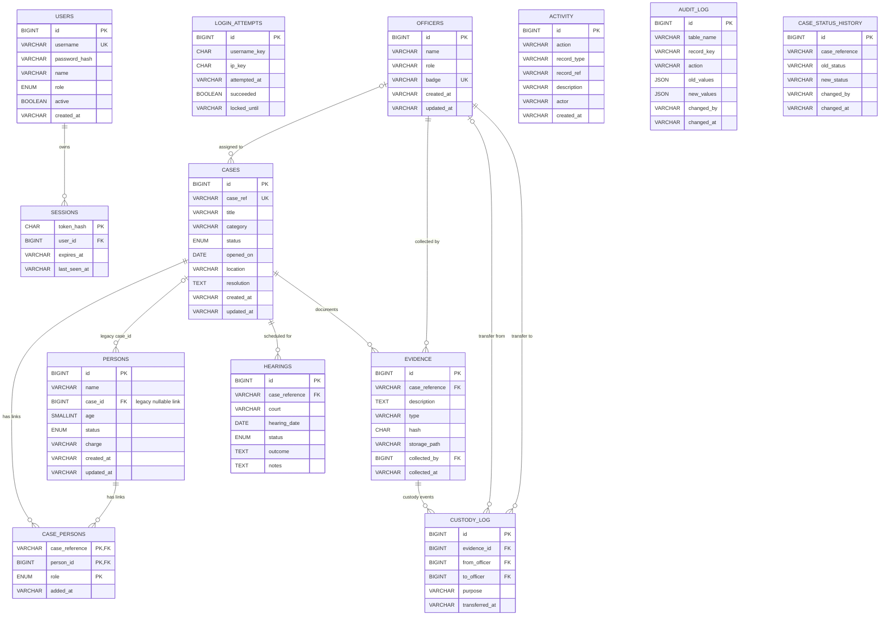

# CASEWORK database ER diagram

The diagram describes the MySQL target schema in `database/schema.mysql.sql`. It shows physical foreign-key relationships. The legacy nullable `persons.case_id` link is retained for older clients; new person-to-case links use `case_persons`.

`case_persons` is the normalized many-to-many link and allows one person to have several roles or case links. `persons.case_id` is a compatibility field and is not the canonical relationship. `activity.actor`, `audit_log`, and `case_status_history` keep audit references without foreign keys so history can remain available independently of a user or case row. `login_attempts` stores SHA-256 identifiers for usernames and IP addresses, not the raw values.

## Application role hierarchy

The `users.role` column contains the application role; the hierarchy is enforced by API authorization and the UI:

1. **Management Head** — highest privilege; can manage user accounts and all case, person, team, evidence, and hearing operations.
2. **Administrator** — can manage cases, persons of interest, team members, evidence, and hearings, but cannot manage user accounts.
3. **Operator** — read-only access to the application records; cannot change cases, persons, team members, or user accounts.

The reporting views are not repeated as entities because they do not store rows: `case_view`, `officer_workload_view`, `repeat_persons_view`, and `public_case_view` are documented in [DATA_DICTIONARY.md](DATA_DICTIONARY.md).
